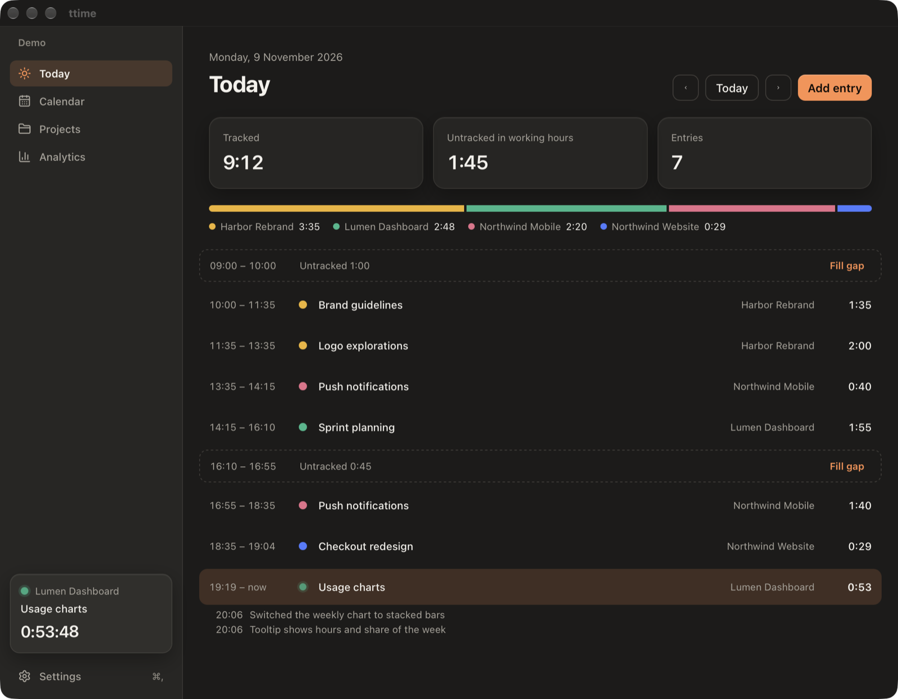
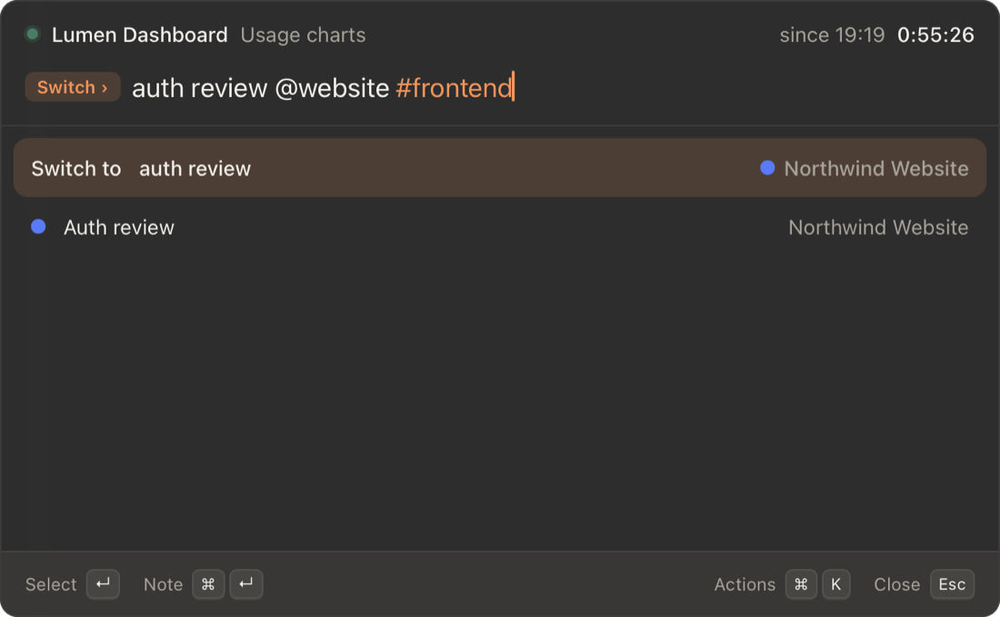
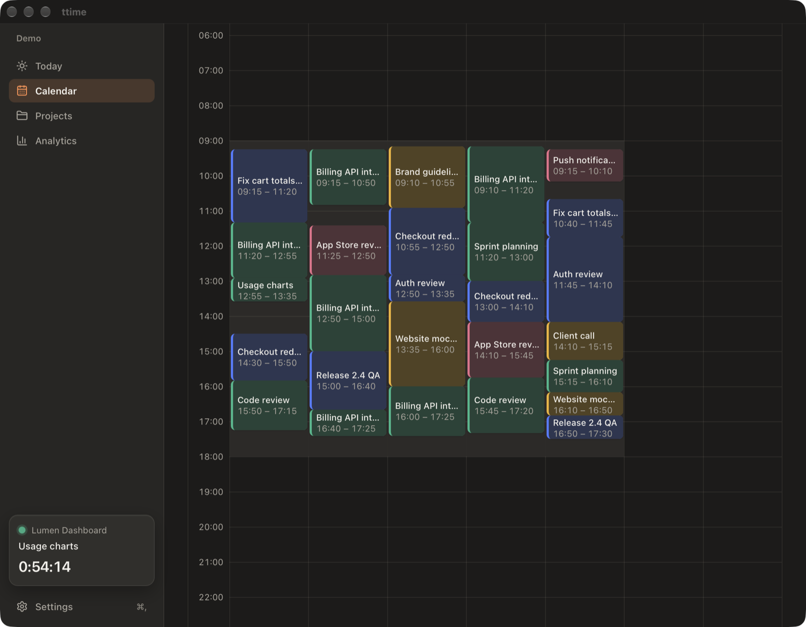
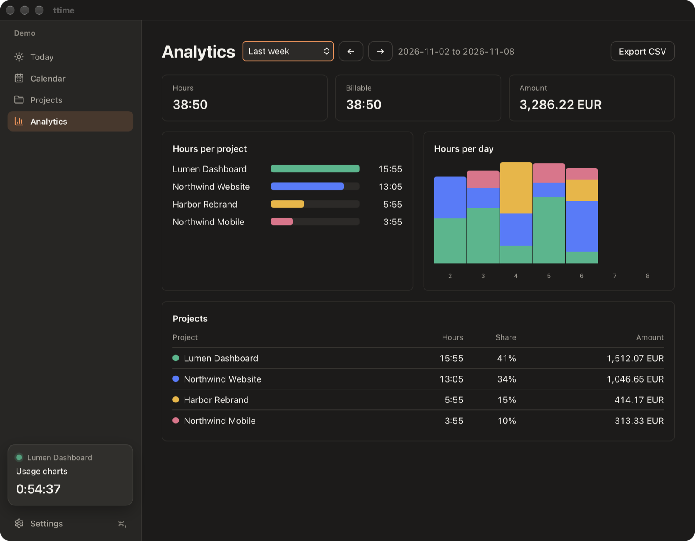
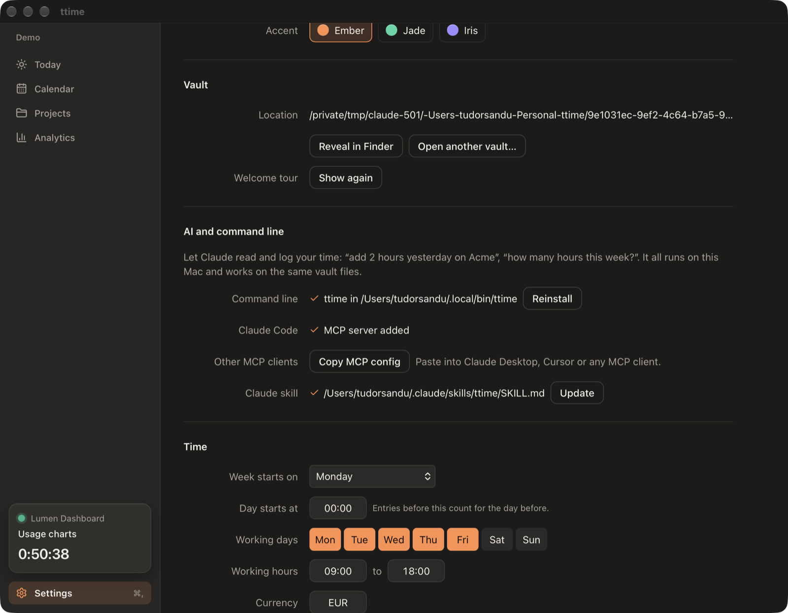
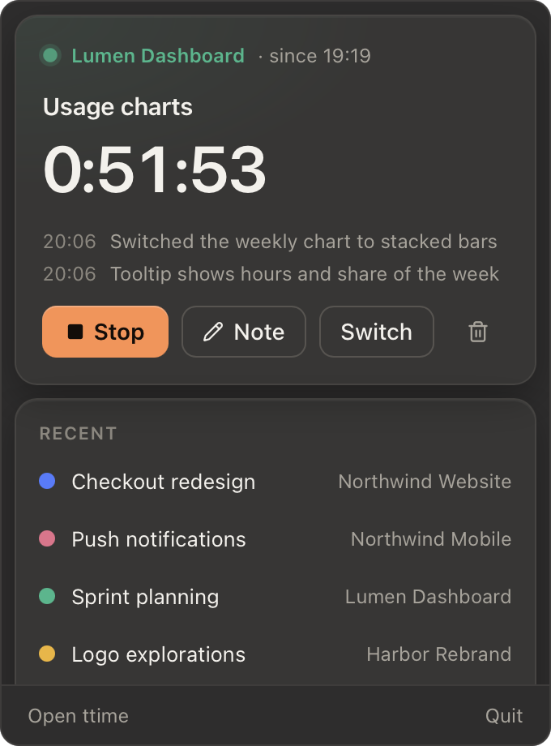

# ttime

A local-first time tracker for macOS. Start, switch and annotate work from a global hotkey
without opening a window, see the running timer in the menu bar, and review your week in a
calendar. Your data is plain JSON in a folder you own, and Claude can read and log your time
through a local MCP server.



<table>
  <tr>
    <td width="50%"></td>
    <td width="50%"></td>
  </tr>
  <tr>
    <td></td>
    <td></td>
  </tr>
</table>

<p align="center"></p>

- **Quick bar:** press the hotkey (default `⌥ ⇧ Space`), type `auth review @acme -20m`, press Enter.
  Starting a timer stops the running one at the same instant, so there are never gaps or overlaps.
- **Menu bar:** the running project and time, with Stop, Note, Switch and Resume one click away.
- **Main window:** Today with untracked gaps you can fill, a week calendar with drag editing,
  projects and clients, analytics, and CSV exports for invoicing with rounding only at export.
- **Reliable:** idle and sleep detection, a forgotten-timer alert, end-of-day auto-stop, undo for
  every change, and a broken file is reported but never overwritten.
- **Your files:** one JSON file per day, project and client (see [docs/FORMAT.md](docs/FORMAT.md)).
  Sync it with git, iCloud Drive or Syncthing, or edit it by hand.
- **AI:** the `ttime` CLI and MCP server let Claude answer "how many hours on Acme this week?" or
  "add 2 hours yesterday afternoon for the auth review". Every change it makes is logged and can
  be undone.
- **Private:** no account, no telemetry, no network calls.

Requires macOS 26 on Apple silicon.

## Install

Download the latest `.dmg` from [Releases](https://github.com/SanduT/ttime/releases), open it and
drag ttime to Applications.

To build it yourself, see [CONTRIBUTING.md](CONTRIBUTING.md). A local build runs on your Mac
without any Gatekeeper prompt.

## First run

A short tour asks where to keep your vault, shows the hotkey and offers to open ttime at login.
ttime needs no macOS permissions.

## Command line and AI

Open Settings > AI and command line:

1. **Install** puts `ttime` on your PATH (`~/.local/bin/ttime`, a link into the app).
2. **Add to Claude Code** registers the MCP server. For Claude Desktop, Cursor or another MCP
   client, **Copy MCP config** and paste it into that client's settings.
3. **Install** the Claude skill so Claude knows how ttime works.

Some commands:

```sh
ttime status                                  # what is running, today and this week
ttime start "auth review @acme-website #backend"
ttime note "finished the login flow"
ttime stop
ttime add --project acme-website --date yesterday --duration 2h --desc "auth review"
ttime report --period this-week --group project
ttime export --project acme-website --period last-month
ttime undo
```

Run `ttime --help` for every command. Add `--json` for machine-readable output; `ttime mcp`
starts the MCP server over stdio.

## Documentation

- [docs/FORMAT.md](docs/FORMAT.md): the vault format, a public contract.
- [docs/PRD.md](docs/PRD.md) and [docs/ARCHITECTURE.md](docs/ARCHITECTURE.md): what ttime does
  and how it is built.
- [PRIVACY.md](PRIVACY.md): what ttime stores and where.
- [CHANGELOG.md](CHANGELOG.md).

## License

[MIT](LICENSE)
